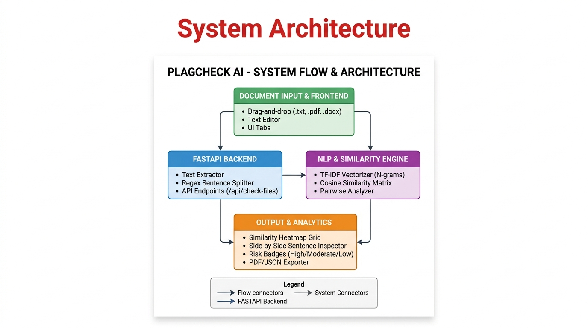
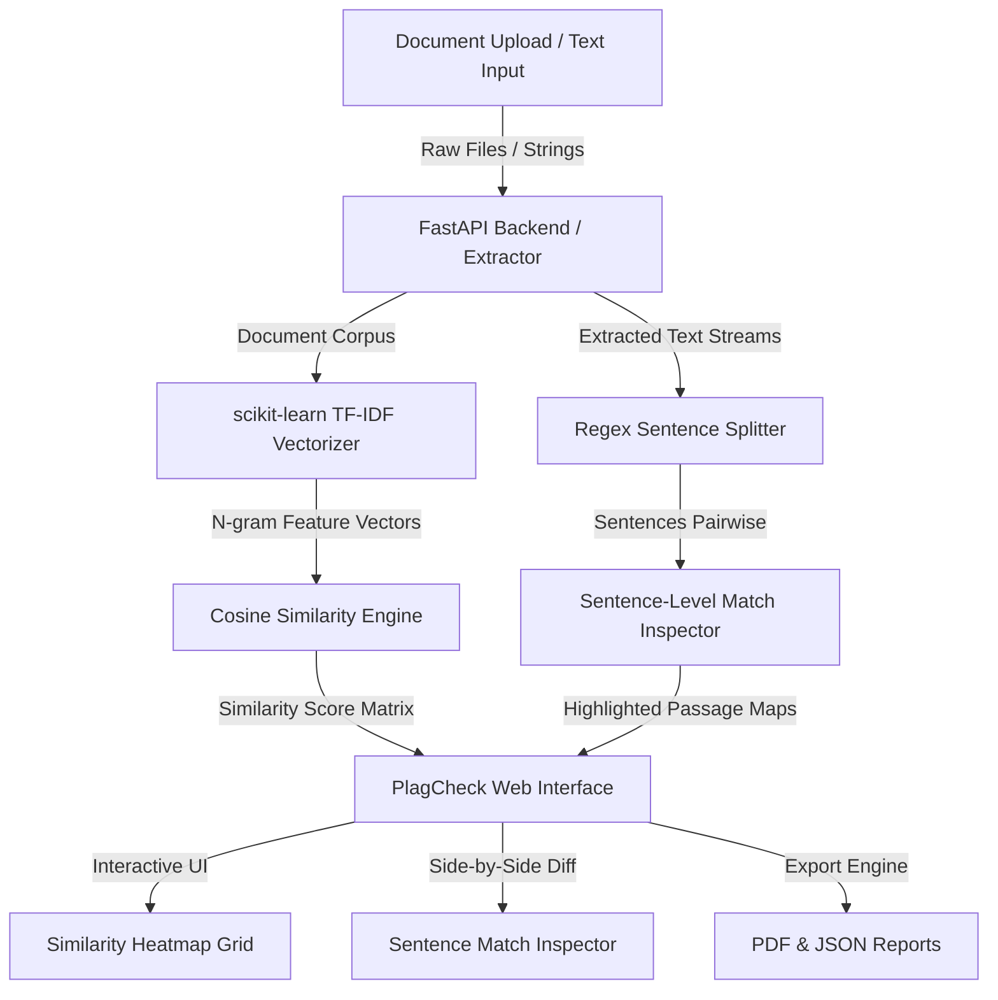

# 🏛️ PlagCheck AI - System Architecture & Data Flow

This document details the system design, component hierarchy, and data pipeline of the **PlagCheck AI** platform.

---

## 📸 System Architecture Diagram

---

## 🔄 Component Breakdown & Data Pipeline

### 1. Document Input & Frontend Layer (`public/`)
- **Multi-File Batch Handler**: Drag-and-drop zone supporting `.txt`, `.pdf`, `.docx`, `.md`, and code files.
- **Quick Text Comparator**: Direct text editors with real-time character counting.

### 2. FastAPI Backend & Extraction Layer (`api/index.py`)
- **Text Parsers**: `pypdf` for PDF page extraction, `python-docx` for Word documents, and native UTF-8 streams for text files.
- **Preprocessors**: Regex sentence segmenter (`re.split(r'(?<=[.!?])\s+|\n+')`) and string normalizer.

### 3. NLP & Similarity Engine
- **TF-IDF Vectorizer**: Tokenizes text corpus with unigrams and bigrams (`ngram_range=(1, 2)`), applying English stop-word filtering.
- **Cosine Similarity Matrix**: Computes directional cosine angle distance across all vector representations.
- **Sentence-Level Match Inspector**: Cross-compares sentence matrices to identify identical and rephrased passages.

### 4. Presentation & Analytics Layer
- **Similarity Heatmap Matrix**: Color-coded grid displaying percentage scores across all file pairs.
- **Risk Badging System**: Automated risk classification (**High $\ge$ 50%**, **Moderate 20–49%**, **Low < 20%**).
- **Side-by-Side Match Inspector**: Highlights matched sentences in yellow/orange across document pairs.
- **Export Capabilities**: Exports complete analysis payloads as JSON or printable PDF reports.
